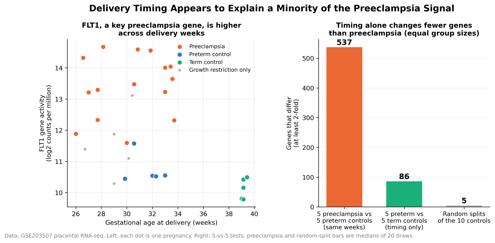

# Read Between The Lines: Is It Preeclampsia, or Just an Early Delivery?

OpenBio 2026 Datathon, Track 1: Maternal-Fetal Cell Communication in Preeclampsia



## Team

- Dheer Doshi
- Jill Liang
- Manasvi Ghonge
- Sanjna Bandaru

## Research Question

How much of the difference in placental gene activity between early-onset preeclampsia and control pregnancies could be explained by when delivery happened? (Starter question 6)

## Data Used

- [x] GSE203507 bulk RNA-seq (required): 30 placentas, one per pregnancy
- [x] Zeisel/Admati gene browser (required): FLT1, ENG, PAPPA2, LEP and HLA-G, used for cell types only
- [ ] Admati/Skarbianskis single-cell pseudobulk files (optional): not used, because the early-onset comparison has only 3 control donors
- [ ] Other public data: none

## How to Run

1. Clone the [datathon repository](https://github.com/Harvard-Undergraduate-OpenBio/openbio-datathon-2026). This folder lives at `submissions/Read-Between-The-Lines/`, and the notebook finds the data in `track-01/data` automatically.
2. Set up the environment from [Track 1 Setup](https://github.com/Harvard-Undergraduate-OpenBio/openbio-datathon-2026/blob/main/track-01/1-setup.md):

   ```bash
   conda env create -f environment/environment.yml
   conda activate openbio-datathon-2026
   ```

3. Open `notebooks/track01_workflow.ipynb` and choose **Restart & Run All**. It takes about 10 to 20 minutes on a laptop, and longer on Google Colab. Most of the time goes to the 20 repeated tests in Section 10. Figures and tables are saved to `notebooks/results/`.

Reproducibility details:

- Notebook: `notebooks/track01_workflow.ipynb` (one notebook, runs top to bottom)
- Where we ran it: our own computer, using the datathon environment (Python 3.11, PyDESeq2 0.5.4). The saved outputs and every number in our documents come from this setup.
- Note: Google Colab installs a newer PyDESeq2 (0.6.0). That gives slightly different counts (for example 532 instead of 522 genes for preeclampsia vs preterm controls), but the same conclusions.
- Random seed: 2026. It is used only for the random tests in Section 10 and for spreading out dots in plots.

## Files

| Path | Contents |
|---|---|
| `notebooks/track01_workflow.ipynb` | The full analysis |
| `figures/` | All graphs, including `headline.png` |
| `docs/Article.md` | Science communication article, following the [HUDP article guide](https://github.com/Harvard-Undergraduate-OpenBio/openbio-datathon-2026/blob/main/docs/article-guide.md) |
| `docs/analysis-plan.md` | The comparisons, model and cutoffs we chose |
| `docs/hypothesis-card.md` | Our hypothesis and how to test it |

## Key Findings

Every early-onset preeclampsia case in this dataset was delivered preterm. So we compared the 15 preeclampsia placentas with 5 preterm controls delivered in the same weeks, and with 5 term controls delivered about 9 weeks later. A gene counted as different if it changed at least 2-fold with an adjusted p-value below 0.05.

- **Matching delivery timing barely changes the count.** 532 genes differ against term controls and 522 against same-week preterm controls, but only 235 genes are on both lists.
- **Timing has a real but smaller effect.** In equal-size tests of 5 vs 5, the two control groups differ in 86 genes. Random splits of the controls give 0 to 17, and preeclampsia vs preterm controls gives 232 to 763 (median 537). So timing's effect is about a sixth the size of preeclampsia's.
- **About half the signal is disease.** Of the 532 genes that differ against term controls, 52% still differ against same-week controls, 28% look driven by timing and 19% are unclear.
- **Known preeclampsia genes hold up.** FLT1 (about 8-fold higher), ENG, LEP and PAPPA2 are raised whatever the delivery week. In the gene browser, FLT1, PAPPA2 and LEP sit mainly in trophoblast cells and ENG mainly in blood-vessel cells.
- **The result survives our checks.** Fold changes stay almost the same (correlation 0.99 to 1.0) after adjusting for fetal growth, the baby's sex or exact delivery week, and after dropping two flagged samples (S01 and S12).

## Limitations

- Only 5 controls of each type.
- The preterm controls are spontaneous preterm births, which often involve inflammation, so they are not a healthy 31-week placenta.
- The random-split noise baseline mixes preterm and term controls, so it still contains some timing signal.
- Bulk tissue mixes many cell types, so we cannot tell changes inside cells from changes in the cell mix.
- Every case is early onset, so the answer may differ for late-onset preeclampsia.
- Growth restriction occurs only in the preeclampsia group, which costs power when we adjust for it.
- Results show association, not cause.

## Presentation

Video link: https://youtu.be/r-HJbUis6js

[Presentation slides](docs/Final%20Version%20-%20Delivery%20Timing%20Explains%20Only%20About%20a%20Quarter%20of%20Preeclampsia%27s%20Placental%20Gene%20Changes.pdf)

## Data Citations

1. Ackerman WE, Buhimschi IA, Buhimschi CS, et al. Molecular subphenotyping using placental transcriptomics in early-onset preeclampsia and fetal growth restriction. NCBI GEO [GSE203507](https://www.ncbi.nlm.nih.gov/geo/query/acc.cgi?acc=GSE203507).
2. Admati I, Skarbianskis N, et al. Two molecular faces of preeclampsia. [Zeisel lab placenta gene browser](https://storage.googleapis.com/www_zeisellab/PE_web/pe_web_test_v1.html); data on [Figshare](https://doi.org/10.6084/m9.figshare.23264102.v1) (CC BY 4.0).
3. OpenBio Datathon 2026 Track 1 [marker table](https://github.com/Harvard-Undergraduate-OpenBio/openbio-datathon-2026/blob/main/track-01/data/interpretation/track01_marker_matrix.csv).
4. Muzellec B, et al. PyDESeq2: a Python package for bulk RNA-seq differential expression analysis. Bioinformatics (2023). [doi:10.1093/bioinformatics/btad547](https://doi.org/10.1093/bioinformatics/btad547)

