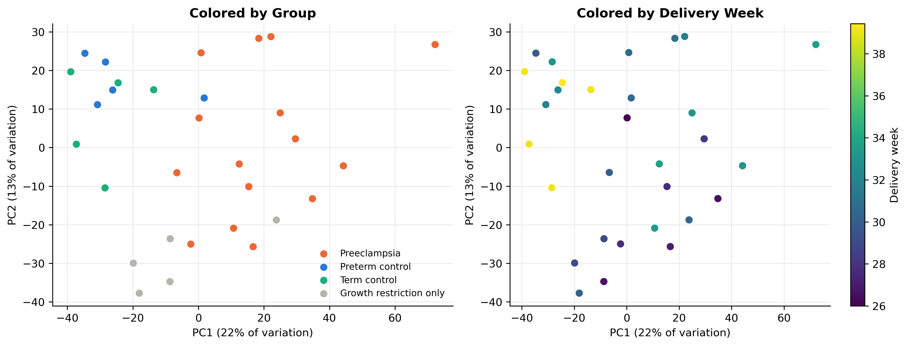
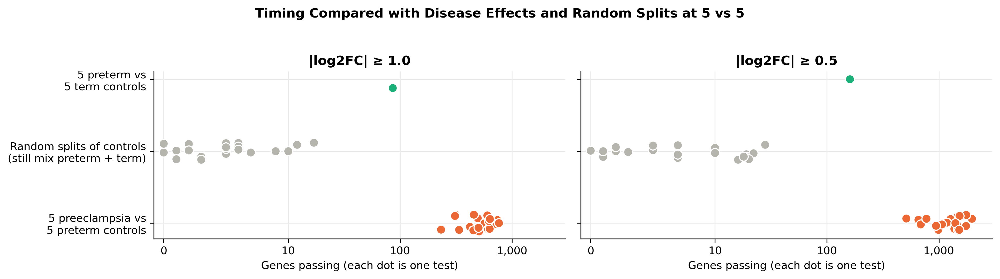
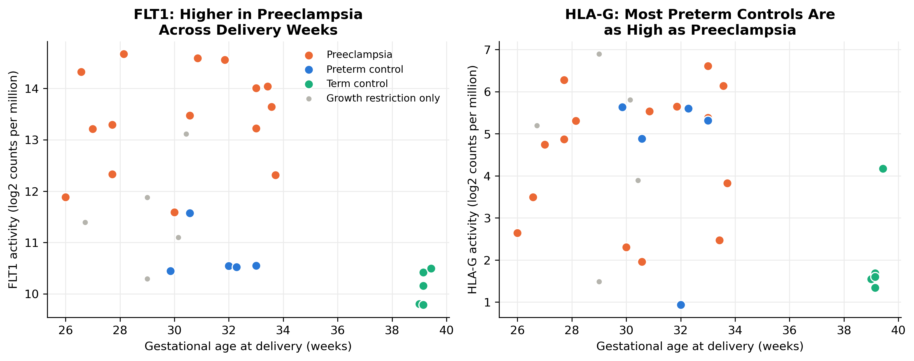

# Delivery Timing Explains Only About a Quarter of Preeclampsia's Placental Gene Changes

**Every early-onset preeclampsia case was delivered preterm, so we compared these placentas with controls delivered in the same weeks to separate the disease from the extra weeks of pregnancy.**

By Dheer Doshi, Jill Liang, Manasvi Ghonge, Sanjna Bandaru

*Figure 1. Delivery timing changes far fewer genes than preeclampsia does. Left: FLT1 activity in each placenta by delivery week. Nearly every preeclampsia placenta sits above every control, whatever the week. Right: genes that differ at least 2-fold in equal-size tests of 5 vs 5 placentas. Preterm and term controls differ in 86 genes, against a median of 537 for preeclampsia vs preterm controls and 5 for random splits of the controls (medians of 20 draws). (Data: [GSE203507](https://www.ncbi.nlm.nih.gov/geo/query/acc.cgi?acc=GSE203507))*

## Introduction

When preeclampsia strikes early in pregnancy, a mother's blood pressure can climb to life-threatening levels months before her due date. Doctors believe the crisis begins in the placenta, the temporary organ that connects the mother to the fetus to supply oxygen and nutrients. In most situations, the only way to protect both mother and baby is to deliver the baby early (preterm), which still carries significant complications. A placenta changes rapidly from week to week as a pregnancy matures. If we compare a preterm placenta delivered at 30 weeks with a control placenta delivered at full term (39 weeks), we cannot tell which genes reflect the disease and which reflect the earlier delivery. Mistaking normal mid-pregnancy biology for disease could send drug developers chasing the wrong targets. We set out to untangle those two forces and measure how much of preeclampsia's gene signature is driven by the disease versus the timing of delivery.

## The Data and Our Methods

We analyzed gene-activity records (RNA-seq) from 30 human placentas in the public dataset [GSE203507](https://www.ncbi.nlm.nih.gov/geo/query/acc.cgi?acc=GSE203507), measuring 15,835 genes after removing nearly silent ones. Each placenta comes from a different pregnancy, so each counts once. Every preeclampsia case in this dataset was delivered preterm, so comparing them with full-term placentas mixes up the disease with extra weeks of pregnancy. To separate the two, we compared 15 early-onset preeclampsia cases (26 to 34 weeks) with two control groups: 5 spontaneous preterm births delivered in the same window (30 to 33 weeks) and 5 term births (about 39 weeks). We excluded 5 growth-restriction-only pregnancies from all tests. We mapped overall gene activity on a summary chart (principal component analysis, or PCA) and used [PyDESeq2](https://doi.org/10.1093/bioinformatics/btad547) to find genes with at least a 2-fold change and an adjusted p-value below 0.05. We compared preeclampsia against each control group and against all 10 controls pooled, and the two control groups against each other. We then checked which cell types use these genes with the [Track 1 marker table](https://github.com/Harvard-Undergraduate-OpenBio/openbio-datathon-2026/blob/main/track-01/data/interpretation/track01_marker_matrix.csv) and the [Zeisel/Admati placental gene browser](https://storage.googleapis.com/www_zeisellab/PE_web/pe_web_test_v1.html). Our insights are limited by having only 5 controls per group, by spontaneous preterm births often involving inflammation, by bulk tissue blending many cell types, and by every case being early onset.

## What We Found

**Preeclampsia placentas look different from both kinds of control.** We started by asking which samples resemble each other overall. Each placenta has an activity reading for about 16,000 genes. Gene activity means how many copies of a gene's message the cells were making, measured by counting sequencing reads. We used principal component analysis (PCA), which squeezes those 16,000 readings into one position on a chart, so placentas with similar activity land close together. The biggest pattern in the data sorts preeclampsia placentas away from everything else, while preterm and term controls, born about 8 weeks apart, land almost on top of each other. Among the 10 control placentas, delivery week explains only about 6% of that pattern. If timing were driving things, the preterm controls would sit next to the preeclampsia cases. They sit with the term controls instead.

*Figure 2. Each dot is one placenta. Preterm and term controls cluster together on the left, and preeclampsia placentas spread to the right. (Data: GSE203507)*

**Hundreds of genes differ, including well-known preeclampsia genes.** We compared the 15 preeclampsia placentas with the 5 preterm controls, which were delivered in about the same weeks (30.2 and 31.5 weeks on average). A gene counted as different if its activity changed at least 2-fold and the evidence was strong. Fold change is the ratio between groups: 2-fold means twice as active, or half as active. Strong evidence means an adjusted p-value below 0.05, so we expect about 5% of the genes we flag to be false alarms. 472 genes passed: 283 more active in preeclampsia and 189 less active. Several of the clearest hits are genes already linked to the disease:

- **FLT1,** about 8-fold higher. It makes sFlt-1, a protein that blocks blood-vessel growth, and doctors already measure it in blood tests for preeclampsia.
- **ENG,** about 4-fold higher. It makes endoglin, another protein that blocks blood-vessel growth.
- **LEP and PAPPA2,** about 43-fold and 3.5-fold higher. Both have been reported to be raised in preeclamptic placentas.

**Swapping the control group barely changes the count, but it changes the list.** We ran the same test against term controls, born about 9 weeks later than the cases. 532 genes pass against term controls and 522 against same-weeks preterm controls. If timing drove the signal, the term comparison should have found far more. One thing surprised us: the totals nearly match, but the gene lists overlap by less than half, with only 235 genes in both. Part of that is noise from having only 5 controls per group, and part is timing, which the next two results measure.

**At equal sample size, timing has a real but smaller effect.** Five controls per group is a small test, and a small test can miss real differences. To check, we ran 20 repeated tests of 5 random preeclampsia cases against the 5 preterm controls. As a noise baseline, we split the 10 controls into random groups of 5, also 20 times. Then we tested the 5 preterm controls against the 5 term controls at that same size.

- **Preeclampsia vs preterm controls:** 232 to 763 genes, with a median of 537.
- **Random splits of the controls:** 0 to 17 genes, with a median of 5.
- **Preterm vs term controls:** 86 genes.

Timing clearly beats noise, so eight extra weeks of pregnancy do change the placenta. But at the same sample size, that change is about a sixth the size of the preeclampsia signal. The pattern holds at a looser 1.4-fold cutoff: 509 to 1,971 genes for preeclampsia, 0 to 28 for random splits and 160 for timing.

*Figure 3. Each dot is one 5-vs-5 test, at the 2-fold cutoff (left) and the looser 1.4-fold cutoff (right). Timing sits well above random splits and well below preeclampsia. (Data: GSE203507)*

**Gene by gene, about half of the difference holds up as disease.** For each of the 532 genes that differ between preeclampsia and term controls, we split the gap into two parts. The disease part is the gap that remains against same-weeks preterm controls. The delivery-age part is the gap between preterm and term controls. About half of these genes (52%) still differ against same-weeks controls, so we read them as disease genes. About a quarter (28%) shrink toward zero, so they look driven by timing. The rest (19%) are too noisy to call. For the typical gene, timing accounts for about 30% of the gap.

*Figure 4. Each dot is one gene. Genes on the diagonal show the same difference against either control group. Genes that fall toward the horizontal axis lose their difference once delivery timing is matched. (Data: GSE203507)*

**Two genes show the two patterns.** FLT1 is higher in nearly every preeclampsia placenta than in any control, whether the baby was born at 26 weeks or 34. HLA-G looks raised in preeclampsia only against term controls; four of the five preterm controls are just as high, so it behaves like a timing gene. In a single-cell map of the placenta from another study, HLA-G appears only in extravillous trophoblast, the cells that anchor the placenta into the uterine wall. We speculate that preterm and term samples may contain different amounts of that tissue, rather than the cells themselves changing.

*Figure 5. Each dot is one placenta, plotted by delivery week. FLT1 (left) separates preeclampsia from controls at every week. HLA-G (right) is high in preterm controls too. (Data: GSE203507)*

**The main result survives our double-checks.** We reran the main comparison while also accounting for the baby's sex, poor fetal growth or the remaining 1.3-week age gap, and again with two flagged samples (S01 and S12) removed. In every version, the size and direction of each gene's difference stayed almost identical (correlation 0.99 to 1.0). The share of the 522 main genes that stayed significant varied:

- **Accounting for the age gap:** 87%
- **Dropping S01 and S12:** 85%
- **Accounting for sex:** 78%
- **Accounting for poor fetal growth:** 53%. This drop is mostly lost statistical power rather than lost signal, since the effect sizes did not change.

## Unanswered Questions

**Do timing genes change inside cells, or does the cell mix change?** Bulk RNA-seq measures the whole sample at once. We can't tell whether timing genes like HLA-G change inside cells or whether preterm and term samples just contain different amounts of certain cell types. HLA-G points toward cell mix, but that rests on one gene.

**Why do the two gene lists overlap so little?** Against term controls 532 genes pass, and against preterm controls 522 pass, yet only 235 genes are on both lists. With 5 controls per group, we can't say how much of that gap is noise and how much is timing.

**How large is the timing effect?** Our estimate depends on how we test it. The three-group model found 11 timing genes, and the equal-size 5 vs 5 test found 86. We trust 86 more because it matches the size of our other tests, but the true number is uncertain.

**Is poor fetal growth tangled up with preeclampsia?** Adjusting for it cut the significant genes from 472 to 293, though the effect sizes held. Growth restriction appears only among the preeclampsia cases we tested, so with 15 cases we can't fully separate the two.

**Would the answer hold for late-onset preeclampsia?** Every case in this dataset is early onset. Late-onset disease is more common and may involve different biology, so our results may not carry over.

## Conclusions, Limitations and Next Steps

Delivery timing explains only a minority of the difference between early-onset preeclampsia and control placentas in this dataset. Comparing against controls delivered in similar weeks barely changes the number of genes that differ (532 against term controls, 522 against preterm controls). The two lists only partly overlap (235 genes shared), so the exact genes are sensitive to which controls are used.

Delivery timing also has a real but smaller effect of its own. In equal-size comparisons (5 vs 5), preterm and term controls, delivered about 8 weeks apart, differ in 86 genes: more than random splits of the controls, but about six times fewer than preeclampsia. About half (52%) of the differences against term controls hold up against preterm controls, about a quarter (28%) look driven by timing and 19% are unclear. These patterns hold after adjusting for poor fetal growth, the baby's sex or exact delivery week, and after removing two flagged samples (S01 and S12), with fold-change correlations of 0.99 to 1.0. Adjusting for fetal growth costs statistical power and leaves 53% of genes significant.

**Our hypothesis:** most placental gene changes in early-onset preeclampsia come from the disease itself, not from being delivered early, and timing adds a smaller, separate effect. We speculate that part of the timing effect reflects how much extravillous trophoblast (the cells that anchor the placenta into the uterine wall) ends up in preterm versus term samples, since several timing-driven genes, such as HLA-G and PRG2, are associated with those cells. Our results suggest that most of preeclampsia's placental gene signature reflects the disease rather than early delivery, but they show association, not cause.

**Limitations.** Our results are limited by having only five pregnancies in each non-preeclampsia group. Because healthy pregnancies are not delivered early, we had to use spontaneous preterm births as controls, and these often involve inflammation. Our random splits mix preterm and term controls, so they are a rough noise baseline that still contains some timing signal. Bulk tissue mixes many cell types, so we cannot tell whether genes change inside cells or because the mix of cells changes. Every case is early onset, so the answer may differ for late-onset preeclampsia.

**Next steps.** We would repeat the delivery-timing comparison inside individual placental cell types using single-cell data, to separate changes inside cells from shifts in cell mix. We would also check whether FLT1, ENG, LEP and PAPPA2 stay elevated in an independent group of pregnancies delivered early for medical reasons rather than spontaneous preterm labor.

## Data and Code

- **Repository:** [Read Between The Lines submission folder](https://github.com/Harvard-Undergraduate-OpenBio/openbio-datathon-2026/blob/main/submissions/Read-Between-The-Lines)
- **Data sources:**
  - [GSE203507](https://www.ncbi.nlm.nih.gov/geo/query/acc.cgi?acc=GSE203507): bulk RNA-seq of villous placental tissue (Ackerman et al.)
  - [Zeisel/Admati placental gene browser](https://storage.googleapis.com/www_zeisellab/PE_web/pe_web_test_v1.html): single-cell map from a different preeclampsia study, used for cell-type context only
  - [Track 1 marker table](https://github.com/Harvard-Undergraduate-OpenBio/openbio-datathon-2026/blob/main/track-01/data/interpretation/track01_marker_matrix.csv) (`track01_marker_matrix.csv`), from the OpenBio Datathon 2026 data package
- **Software:** PyDESeq2 0.5.4 (Python 3.13)

## Acknowledgements

We thank the OpenBio Datathon team for logistical support and for answering our questions. This article follows the [Harvard Undergraduate Data Project (HUDP)](https://www.hudp.org/) article guide.
