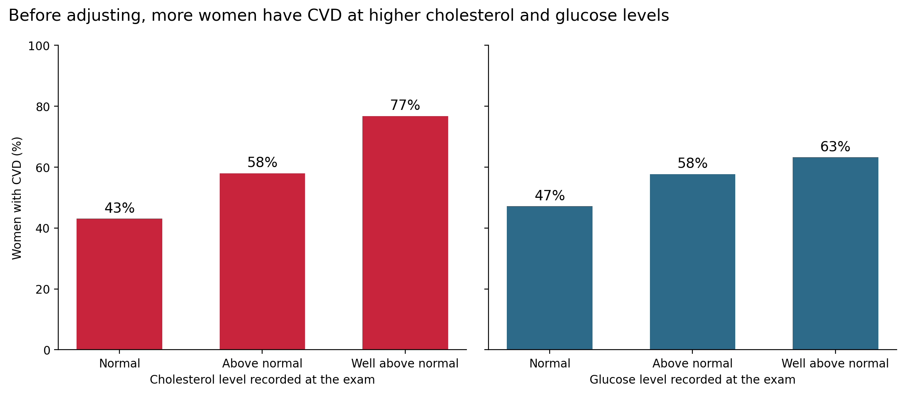
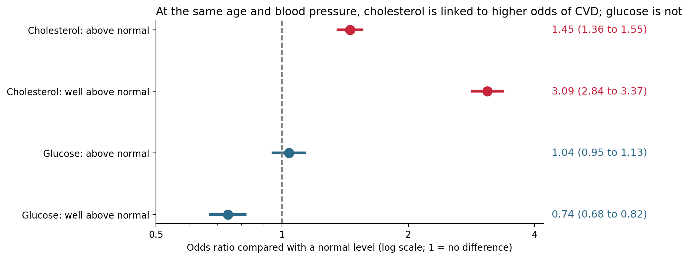
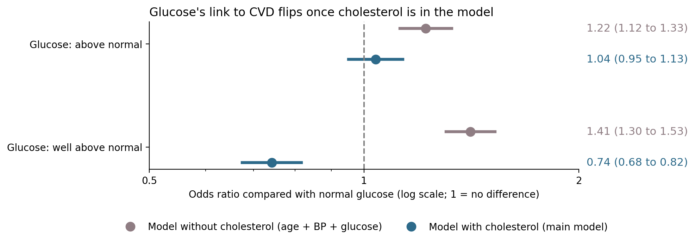
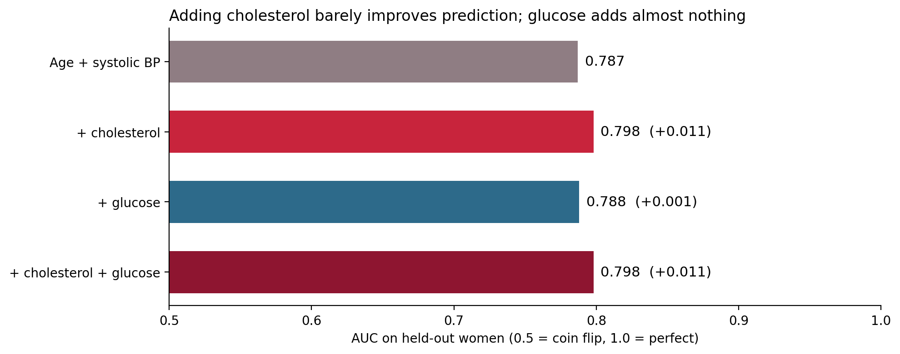
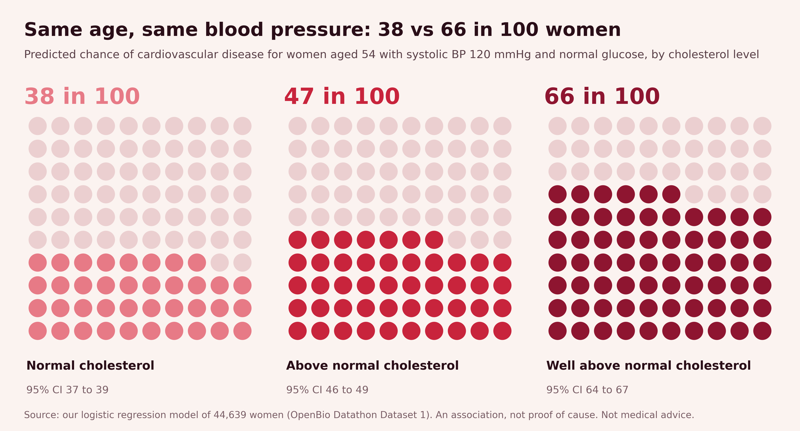
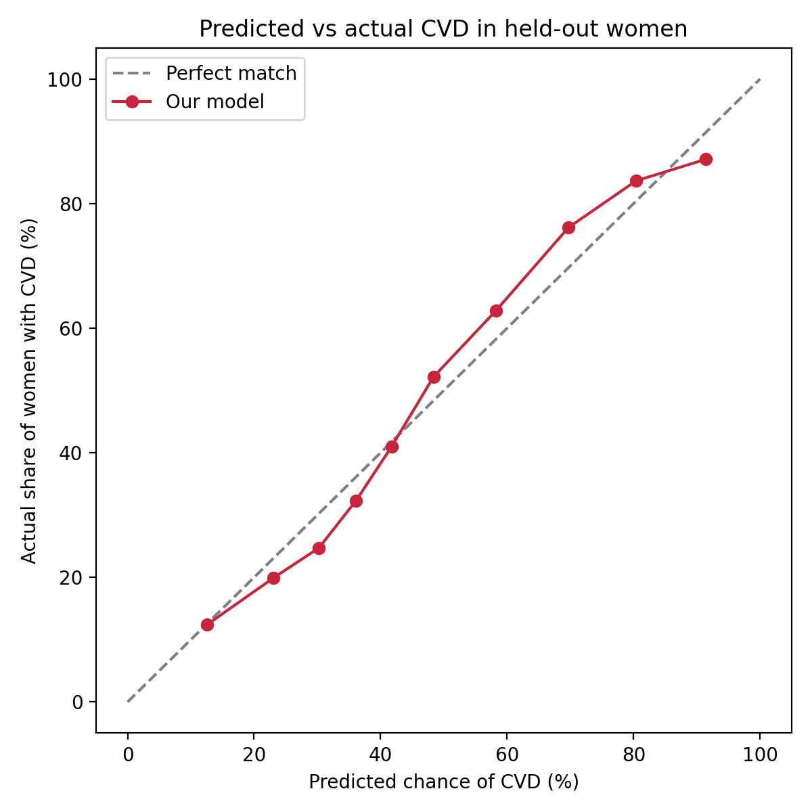

# Beyond Age and Blood Pressure

### In more than 44,000 women, cholesterol carried information about cardiovascular disease that age and blood pressure missed. Glucose did not.

*By Adam Cramer, Ava Kaang, Gabriella Canale and Maneli Paknejad · Harvard Undergraduate OpenBio Datathon 2026, Track 2*

## Introduction

Cardiovascular disease (CVD), which includes heart disease and stroke, is the leading cause of death worldwide, killing 19.2 million people in 2023. That year, ischemic heart disease caused 3.94 million deaths among women and stroke caused another 3.29 million ([GBD 2023 CVD Collaborators, 2025](https://doi.org/10.1016/j.jacc.2025.08.015)). Despite this toll, CVD is often under-recognized in women, leading researchers to call for better recognition, especially in younger women, who have traditionally been overlooked in prevention ([Li et al., 2025](https://pmc.ncbi.nlm.nih.gov/articles/PMC12237364/)). This is partly because women have historically been underrepresented in cardiovascular clinical trials ([Michos et al., 2021](https://doi.org/10.1016/j.ajpc.2021.100250)), and their heart attack symptoms do not always follow the patterns more commonly seen in men ([van Oosterhout et al., 2020](https://doi.org/10.1161/JAHA.119.014733)). As a result, recognizing and understanding cardiovascular disease in women remains an important area of research.

Age and blood pressure are currently well established risk factors for CVD, but other measures like cholesterol and blood glucose may offer additional insight into factors associated with the disease. This is amplified with conditions like diabetes, which increases the risk of coronary heart disease in women more than in men ([Peters et al., 2014](https://dro.deakin.edu.au/articles/journal_contribution/Diabetes_as_risk_factor_for_incident_coronary_heart_disease_in_women_compared_with_men_A_systematic_review_and_meta-analysis_of_64_cohorts_including_858_507_individuals_and_28_203_coronary_events/20737474)).

So we asked:

**Among women aged about 30 to 65, do cholesterol and glucose levels tell us anything about cardiovascular disease beyond age and blood pressure?**

We found that cholesterol is strongly associated with CVD and slightly improves prediction, while glucose adds almost nothing once age and blood pressure are known.

## The Data and Our Methods

For our analysis, we used the [Cardiovascular Disease dataset](https://www.kaggle.com/datasets/sulianova/cardiovascular-disease-dataset) from the [OpenBio Datathon repository](https://github.com/Harvard-Undergraduate-OpenBio/openbio-datathon-2026), which was the only dataset with "real-world-style" individual records (the other two are synthetic or describe whole countries). It holds 70,000 medical exam records with age, height, weight, blood pressure, cholesterol and glucose levels, and an indication of whether the patient has CVD. Cholesterol and glucose are recorded only as normal, above normal or well above normal, and the dataset does not say where or when it was collected. Of the dataset’s 45,530 women, we removed 21 duplicate rows and 870 rows with impossible values (such as a systolic reading lower than the diastolic one), leaving 44,639 entries (cleaning rules in the [Appendix](#appendix)). We used logistic regression, which estimates how strongly each factor is linked to a yes-or-no outcome while holding the others fixed, and we scored every model on 20% of women it had never seen. We recognize that the data represents a single snapshot, and therefore our results show association, not cause.

## What We Found

### Before adjusting, CVD rises with both

The women in the dataset were 53 years old on average, and 49% had CVD. The share with CVD rose from 43% at normal cholesterol levels to 58% and 77% at higher ones. The prevalence of CVD also went from 47% at normal glucose to 58% and 63% (Figure 1). It is worth noting, however, that women with high cholesterol or glucose also tended to be older and to have higher blood pressure, so we needed to account for both.

*Figure 1. Share of women with CVD at each cholesterol and glucose level, before adjusting for anything (44,639 women).*

### At the same age and blood pressure, cholesterol still matters

An odds ratio (OR) compares the odds of CVD between two groups: 1 means no difference, and the 95% confidence interval (CI) is the range of values our data support. Compared with women of the same age, blood pressure and glucose level whose cholesterol was normal, women with well above normal cholesterol had about three times the odds of CVD (OR 3.09, 95% CI 2.84 to 3.37), and women with above normal cholesterol had 1.45 times the odds (Figure 2).

**This held up in every check we ran.** The odds ratio stayed between 2.96 and 3.08 when we added body mass index, smoking, alcohol and physical activity, added diastolic blood pressure, treated systolic blood pressure as bands (such as 120 to 129) instead of a straight line, or cleaned the data with stricter blood pressure ranges (see the Appendix).

*Figure 2. Odds of CVD at each cholesterol and glucose level compared with a normal level, from one logistic regression model that also includes age and systolic blood pressure. Lines show 95% confidence intervals; the dashed line marks no difference.*

### Glucose flips once cholesterol is included

In a model without cholesterol, well above normal glucose went with higher odds of CVD (OR 1.41). Once cholesterol joined the model, that reversed to 0.74 (95% CI 0.68 to 0.82), and above normal glucose showed no clear link, since its confidence interval includes 1 (Figure 3).

That does not mean high glucose protects the heart. The two measures travel together: 67% of women with well above normal glucose also had well above normal cholesterol. Among women with well above normal cholesterol, 69% of those with well above normal glucose had CVD, compared with 83% of those with normal glucose. One possible reason, which we could not test, is that women diagnosed with diabetes may already be on treatment.

*Figure 3. Glucose odds ratios from a model without cholesterol (grey) and with it (blue). Well above normal glucose goes from higher odds to lower odds once cholesterol is included.*

### Cholesterol adds only a little to prediction

A strong link is not the same as better prediction. We measured how well each model separated women with and without CVD using AUC (area under the curve), where 0.5 is a coin flip and 1 is perfect. Age and systolic blood pressure alone scored 0.787. Adding cholesterol raised that to 0.798, a gain of 0.011 (95% CI 0.008 to 0.014), while glucose added just 0.001 (Figure 4). The model's predicted chances were also close to reality: within about 4 percentage points of actual rates, on average (see the Appendix).

*Figure 4. How well each model separates women with and without CVD (AUC), measured on 20% of women held out from fitting. The scale starts at 0.5, a coin flip.*

### What this looks like for one woman

Picture 100 women aged 54 with a systolic blood pressure of 120 and normal glucose. If their cholesterol is normal, our model predicts about 38 of them have CVD. If it is well above normal, about 66. **That is 3.09 times the odds, but about 1.7 times the chance**, a gap worth remembering whenever you see an odds ratio. Real women with a similar profile (aged 50 to 58, with a systolic blood pressure of 120 and normal glucose) show the same pattern: 32% versus 75%.

*Figure 5. Our headline visual: women with well above normal cholesterol had about 3 times the odds of CVD as women with normal cholesterol of the same age and blood pressure. Lines show 95% confidence intervals; the dashed line marks no difference.*

## Unanswered Questions

- **Why is well above normal glucose linked to less CVD once cholesterol is included?** Without medication or diagnosis data, we cannot test the treatment idea.
- **What does the 49% rate mean?** We do not know how patients were chosen, so the dataset may over-sample people who are already ill.
- **Does high cholesterol come before CVD?** A single snapshot cannot tell us.

## Conclusions, Limitations and Next Steps

In our dataset of 44,639 women, those with well above normal cholesterol levels had roughly three times the odds of CVD at the same age and blood pressure, and that held in every check. Yet it improved prediction only slightly, while glucose made no impact. So, to answer our question: the inclusion of cholesterol as a predictor for CVD slightly improves prediction over the model of just age and blood pressure, while the inclusion of glucose does not.

However, our results have clear limits, and do not show cause. We cannot claim that lowering cholesterol would prevent CVD, which would take longitudinal studies that follow people over time. Additionally, we do not know where, when, or how the patients were chosen, and nearly half of them have CVD, so they may not represent the female population in general. Another limitation is that cholesterol and glucose come in three broad levels rather than lab values. Moreover, there are no diabetes diagnoses or medication data, and the CVD indication is a single yes-or-no label. Finally, sex is recorded only as a binary code, so our results cannot speak beyond it; the code for women was inferred from average height (161 vs 170 cm), as the datathon's [data dictionary](https://github.com/Harvard-Undergraduate-OpenBio/openbio-datathon-2026/blob/main/track-02/data/data_dictionary.md) notes.

Future work should test the cholesterol finding with laboratory measurements, such as LDL cholesterol and HbA1c, which would reflect average blood sugar over the previous two to three months. Furthermore, medication records could help explain the glucose results and longitudinal studies following women over time could help demonstrate whether high cholesterol comes before CVD.

*This article is a student data analysis. It is not medical advice or clinical guidance.*

## Data and Code

- Team repository: [github.com/adamcramer400/cvd-women--team-trench-](https://github.com/adamcramer400/cvd-women--team-trench-)
- Notebooks: `notebooks/01_cleaning.ipynb` (writes the cleaning log, `docs/cleaning_log.md`) and `notebooks/02_analysis.ipynb`, which reproduces every number and figure in this article (figures are saved in `figures/`)
- Data: [Cardiovascular Disease dataset](https://www.kaggle.com/datasets/sulianova/cardiovascular-disease-dataset), Svetlana Ulianova, Kaggle, 2019 (license listed as "Unknown"), distributed through the [OpenBio Datathon repository](https://github.com/Harvard-Undergraduate-OpenBio/openbio-datathon-2026). The data contain no names or direct identifiers.

## Acknowledgements

We thank the Harvard Undergraduate OpenBio Datathon organizers and mentors, and the [Harvard Undergraduate Data Project](https://www.hudp.org/), whose article guide we followed.

## Appendix

### Cleaning rules (applied in order)

Age was converted from days to years (days ÷ 365.25) before any rule was applied.

| Rule | Removed | Remaining |
|---|---:|---:|
| Duplicate patient IDs | 0 | 70,000 |
| Rows identical in every column except ID | 24 | 69,976 |
| Keep women (sex code 1) | 24,467 | 45,509 |
| Systolic blood pressure 70–250 mmHg | 151 | 45,358 |
| Diastolic blood pressure 40–150 mmHg | 604 | 44,754 |
| Height 130–200 cm | 55 | 44,699 |
| Weight 35–200 kg | 12 | 44,687 |
| Systolic higher than diastolic | 48 | 44,639 |

### Models compared

All four models were scored on the same held-out 20% of women. Gains are measured against the first model. Their 95% confidence intervals come from bootstrapping: we re-scored the models on 500 random resamples of the held-out women to see how much each gain could vary by chance.

| Model | AUC | Gain (95% CI) | Cholesterol OR, above / well above | Glucose OR, above / well above |
|---|---:|---:|---:|---:|
| Age + systolic blood pressure | 0.787 | — | — | — |
| + cholesterol | 0.798 | +0.011 (0.008 to 0.014) | 1.46 / 2.70 | — |
| + glucose | 0.788 | +0.001 (0.000 to 0.002) | — | 1.22 / 1.41 |
| + cholesterol + glucose (main model) | 0.798 | +0.011 (0.009 to 0.014) | 1.45 / 3.09 | 1.04 / 0.74 |

A likelihood-ratio test asks whether adding a variable improves a model's fit to the data by more than chance alone would. Every addition passed this test (p < 0.001; a p-value is the probability of seeing an improvement at least this large if the added variable truly contributed nothing). In a sample this large, however, even very small improvements pass such tests, and only cholesterol noticeably improved prediction. The OR for well above normal cholesterol also rose from 2.70 to 3.09 once glucose was added, further evidence that the two measures are intertwined. Confidence intervals for the main model's odds ratios appear in Figure 2, and those for both glucose models appear in Figure 3.

### Robustness checks

Each row changes one analysis choice and reports the odds ratios for well above normal versus normal levels.

| Check | Women | Cholesterol OR (95% CI) | Glucose OR (95% CI) |
|---|---:|---:|---:|
| Main model | 44,639 | 3.09 (2.84 to 3.37) | 0.74 (0.68 to 0.82) |
| + body mass index, smoking, alcohol, activity | 44,639 | 3.00 (2.76 to 3.27) | 0.74 (0.67 to 0.81) |
| + diastolic blood pressure | 44,639 | 3.07 (2.82 to 3.34) | 0.74 (0.68 to 0.82) |
| Systolic blood pressure in bands | 44,639 | 2.96 (2.71 to 3.22) | 0.74 (0.68 to 0.82) |
| Stricter cleaning (systolic 90–200, diastolic 60–120 mmHg) | 44,465 | 3.08 (2.83 to 3.35) | 0.74 (0.68 to 0.82) |

With the stricter cleaning, adding cholesterol and glucose still raised AUC by 0.011 (from 0.781 to 0.792).

### Calibration and a raw-data check

Across ten equal-sized groups of held-out women, sorted by predicted chance, the model's predicted CVD rates differed from the observed rates by 3.6 percentage points on average, with a largest gap of 6.4 points (Figure 6). As a check that does not depend on the model, we also examined real women aged 50 to 58 with a systolic blood pressure of 120 mmHg and normal glucose. Among them, 32% of those with normal cholesterol had CVD (6,112 women), compared with 41% of those with above normal cholesterol (541 women) and 75% of those with well above normal cholesterol (228 women).

*Figure 6. Predicted vs actual CVD rates in held-out women, split into 10 equal groups by predicted chance. Points near the dashed line mean the model's predicted chances match reality.*
